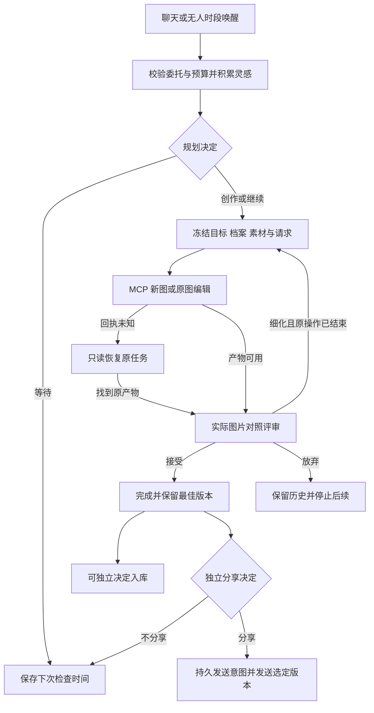

# 小画师自主创作迭代计划

在现有聊天与无人时段统一创作流程上，逐步补齐实际图片对照评审、创作档案、参考素材管理和绘图进度诊断。MaiBot 自主决定画什么、何时继续、是否细化和分享；插件约束授权与预算，独立 MCP 只执行一次确定的绘图操作。

状态：I1～I5 已完成本地实现、模拟验证与独立审查，插件版本 0.9.0，独立 MCP 版本 0.6.0。已在本地已安装 MaiBot 完成模拟模型／绘图下的聊天、无人时段、细化、评审和收图链路验收；真实艺术效果与外部适配器仍未验收，实际证据见 [验证记录](validation.md)。开发基线为插件 0.8.0，提交 `693e12f6cfa5bda9c240016f0cf8b55ec2cbafee`；独立 MCP 基线为 `9abea675f0d770afbfe4c34bd0495c805dcfdc1c`。插件与独立服务分别维护，不跨仓库提交。

本文使用 I1～I5 表示后续迭代，避免与既有阶段 0～6 混淆。总体不变量见 [原始设计](artist-design.md)，当前 Host 接入及验证边界以 [阶段 6](implementation-stage-6.md) 为准；原始设计中阶段 6 的真实验收目标仍需另行完成。

## 自主创作边界

- 聊天消息、无人时段和原任务完成仅提供唤醒，不直接创建绘图任务。保持一个 Artist 推进流程，不另建定时绘图器或自由调用绘图的模型工具链。
- 无人创作仍依赖明确的空间持续委托。自主总开关默认关闭，授权和预算默认不扩大；只收集当前契约允许的委托人消息，不借素材库接入扩大为全群采集。
- 可信身份、服务绑定、发送目标和额度来自 Host 与配置；模型仅返回经过校验的创作建议。图片文字、聊天内容和素材描述均不能授予权限。
- 每次生成、编辑和模型调用沿用原有持久操作账本。未知结果只查原操作，不更换请求编号、不释放未知占用、不以新作品绕过累计修订限制。
- 作品完成、选为参考素材、决定分享是三个独立结果。没有合适作品或分享时机时，可以等待、不画、不分享。
- 不修改 MaiBot 本体，不把 MCP 源码、部署入口或 Codex 凭据放回插件仓库。I1～I3 只需插件变更；I4 属于独立 MCP，I5 才扩展两端协议。

## 研究依据与采纳范围

以下固定源码版本用于追溯设计来源，不表示已运行验证外部项目。只采纳适配本项目的机制，不引入它们的整个执行框架。

| 项目与固定版本 | 已有机制 | 本项目采纳方式 | 不沿用的行为 |
| --- | --- | --- | --- |
| runninghub-workflow-adapter `3da6ac22` | 参数约束、素材角色绑定、按需详情、任务持久恢复 | 有限能力目录、稳定素材句柄、概要与详情分层 | 将工作流执行成功直接视为应该发送 |
| codex-draw `bc9467be` | 命令与模型 Tool、引用图提取、活动等待与总时限 | 可信图片来源解析；MCP 内区分慢任务与停滞 | 插件直接拉起 CLI、缺少源图退化新图、发现文件即认定整个操作结束 |
| maitu-photo-studio `f7026e9d` | 人物／服装／场景参考、选择理由、场景连续性 | 来源与用途分离、系列稳定属性、参考候选筛选 | 单例人物限制、生成即发送、把参考标签合格当成作品质量通过 |

证据入口：

- RunningHub：[素材绑定](https://github.com/achenjins/runninghub-workflow-adapter/blob/3da6ac22fd009d1378e55f0fbf3ee90fb25bee89/rh_generic_lib/media_plan.py#L165-L243)、[按需工具信息](https://github.com/achenjins/runninghub-workflow-adapter/blob/3da6ac22fd009d1378e55f0fbf3ee90fb25bee89/rh_generic_lib/natural_language.py#L49-L98)、[任务恢复](https://github.com/achenjins/runninghub-workflow-adapter/blob/3da6ac22fd009d1378e55f0fbf3ee90fb25bee89/rh_generic_lib/task_runtime.py#L240-L307)。
- codex-draw：[参考图解析](https://github.com/SawataLi/codex-draw/blob/bc9467be978b88c4444afaa8a28b152ea970039c/plugin.py#L267-L318)、[活动判断](https://github.com/SawataLi/codex-draw/blob/bc9467be978b88c4444afaa8a28b152ea970039c/plugin.py#L501-L645)、[工具及发送流程](https://github.com/SawataLi/codex-draw/blob/bc9467be978b88c4444afaa8a28b152ea970039c/plugin.py#L748-L895)。
- maitu：[连续性](https://github.com/tsuiraku9/maitu-photo-studio/blob/f7026e9d849caa8455014d2f837bd76fc6b9b563/maitu_photo/continuity.py#L74-L201)、[参考用途记录](https://github.com/tsuiraku9/maitu-photo-studio/blob/f7026e9d849caa8455014d2f837bd76fc6b9b563/maitu_photo/service.py#L1852-L1885)、[生成后处理](https://github.com/tsuiraku9/maitu-photo-studio/blob/f7026e9d849caa8455014d2f837bd76fc6b9b563/maitu_photo/service.py#L1286-L1315)。

父子图艺术评审、完整创作档案和独立分享闭环是本项目的扩展设计，不归因于上述项目已经实现。

## 当前能力与缺口

| 当前入口 | 已有能力 | 本轮规划的扩展 |
| --- | --- | --- |
| `Artist._review`、`Thinking.review` | 当前图片字节评审，历史版本元数据，允许选择旧最佳版本 | 同时提供当前、父版本及旧最佳版本的实际图片，限制选择范围 |
| `Thinking.plan`、`ArtistStore.plan_work` | 创作意图、主体、情绪、提示词、完成标准 | 冻结创作档案与系列目标，说明本次允许改变的属性 |
| `ArtistStore.remember_inspiration` | 空间内灵感、来源与有效期 | 关联有来源、用途和访问范围的素材；按需选取上下文 |
| `HostThinking`、`HostRuntime` | 实际 Host 能力接线、可信空间、默认关闭 | 多图消息转换；后续按原身份范围读取消息图片 |
| `MCPRenderer`、`Bridge` | 单次 submit/edit、能力发现、原请求恢复 | I5 增加显式参考输入；不改变已有请求摘要 |
| 独立 MCP `codex.py` | 按 thread/turn 处理事件，分离产物与回合状态 | I4 增加活动超时诊断并保留总时限与未知恢复 |

源码入口：[artist.py](../artist.py)、[thinking.py](../thinking.py)、[host_adapters.py](../host_adapters.py)、[store.py](../store.py)、[rendering.py](../rendering.py)、[bridge.py](../bridge.py)。以上表格描述 0.8.0 基线：当时评审仅传当前图片，版本目录不能证明模型已看过历史图。I1 已补充实际多图证据，详见 [I1](implementation-i1.md)；后续契约见 [I2](implementation-i2.md)、[I3](implementation-i3.md) 与 [I5](implementation-i5.md)。

## 实施顺序与交付拆分

| 迭代 | 可独立交付结果 | 依赖与范围 | 完成门槛 |
| --- | --- | --- | --- |
| I1 对照评审 | 当前图、父图、旧最佳图的冻结评审输入和选择证据 | 插件；先验证 Host 多图消息契约 | 能识别改善与退化流程；旧最佳可保留；未知调用不补调 |
| I2 创作档案与系列 | 版本化画风偏好、系列目标、计划快照 | I1；插件 | 同系列保持指定属性，主动变化有理由，旧计划不漂移 |
| I3 参考素材与上下文 | 已有作品入库、来源和用途、有限候选检索 | I2；插件 | 入库与分享独立；跨空间拒绝；重启及撤权不丢审计 |
| I4 绘图进度诊断 | 活动等待、总时限、结构化超时原因 | 可在 I1～I3 后独立交付；MCP | 假事件不续命，持续活动仍受总时限约束，超时不重画 |
| I5 外部与多参考绘图 | 可信聊天图片导入、素材登记、显式多参考契约 | I3；插件与 MCP；I4 非协议前置条件 | 字节实际传入、归属与哈希校验、幂等和旧接口兼容 |

每个迭代先提交契约与迁移方案，再实现最小链路和故障测试，最后独立审查。实际版本号在各迭代发布时分配，不提前承诺五次版本升级。多供应商、通用工作流编辑器、全群媒体采集、向量数据库及自动发表长篇故事暂不纳入。

### I1 实际图片对照评审

**拆分：** I1a 多图输入与能力核实；I1b 评审快照和严格输出校验；I1c 恢复、迁移与 Host 模拟集成。

1. Artist 从同一作品解析 `current`、`parent`、`previous_best`。按版本去重，最多三张；一个版本可同时承担多个角色。逐张通过既有受控取图路径验证真实字节、MIME 和 SHA256。模型不得提供路径、job_id 或跨作品版本。
2. 冻结评审输入后预留一次 `think` 操作。建议增加 `review_contract=2`，保存有序的版本／角色／哈希列表、brief 快照、档案引用和输入摘要；恢复时复用此快照，不用后来改变的 best 或档案重新拼装同一次调用。
3. `Thinking.review` 接收带角色的图片集合；`HostThinking._messages` 转换为带明确图片标识的 Host 多模态内容。实现前核实当前 `llm.generate` 的多图结构、模型配置和大小限制，不把 MCP 的绘图能力声明当作视觉模型能力证明。
4. 输出保留 `decision/reason/strengths/issues` 和细化时的 `edit_prompt/preserve`，新增 `comparison`（改善、退化、保留约束满足情况）与证据版本引用。`best_version_id` 必须属于本次实际送入模型的集合；本轮不提供任意历史版本搜索。若以后需要更早版本，单独生成有预算的新评审快照。
5. 首图只有 current，可作单图评审；存在需要比较的历史图但读取失败、模型不支持多图或响应不能证明执行成功时，保留待评审或未知状态，不伪装成完成对照。明确失败与未知调用分别沿用原有记账规则；不得通过缩减图片或换请求号自动补调未知请求。

评审输出只是建议。Artist 再核对当前授权版本、作品状态、参与版本和原操作，才应用建议；修订仍须等待原绘图操作已确定结束。父图取自当前版本的 `parent_id`，不能误用下一次编辑的 `artist_works.parent_version`。I1 不改变默认编辑父图：继续修改当前版本；如果评审选择旧版本为最佳，可完成并保留旧图。另选旧图作为编辑起点需要后续显式契约，不能暗中改变 `parent_version`。

当前 `best_version` 在首图入库时即可能初始化，修订上限或后端失败也可能令作品进入 finished，因此二者都不能单独证明质量认可。I1 应明确保存或可核验地派生“该版本曾被有效评审接受”的证据，并在分享及后续素材入库时检查；修订预算耗尽只停止绘制，不自动给未认可版本补上接受结论。旧成品不补造认可，缺证据时保留原图并阻止新的自主分享；命令的既有发送行为保持兼容。

保持现有完整运行器的门槛：原图完整可用时可以评审并完成作品，但 `run_once` 会优先对账已完成作品的未决 render，阻止进入新的规划和自主分享；也不开始新作品。I1 不放宽这个门槛。只有原操作得到确定结果后，才恢复独立分享决定，并再次校验授权、预算和发送锁。单独调用 `_share` 可达不代表自主流程可达，相关验收必须从 `tick/run_once` 进入。

**持久化建议：** 为评审记录增加契约版本与输入快照，或增加以原评审 request_id 唯一关联的快照表；具体 DDL 在 I1a 固定。新评审身份使用契约版本、space/work/current_version 和冻结输入摘要派生，再附既有已知失败重试序号。缓存命中与应用同时匹配契约、输入摘要和授权版本；同一当前版本的活跃评审固定一份快照，重复唤醒不因 best 或档案变化生成新身份。所有新身份派生之前仍检查空间内未知 think，不能借升级协议绕过占用。

旧记录标为契约 1，不补造多图证据。旧 `reserved` 评审继续按原参数和契约 1 处理，派发前重新核对授权；保留相应兼容执行路径，不在同一请求下换成多图。旧成功但尚未应用的评审按原契约和授权规则恢复，其缓存不能命中契约 2；未知旧调用保持锁定。没有旧待恢复操作的新评审使用契约 2，旧已完成作品继续可读。

**验收：** 三图及角色去重；不在可见集合内的最佳版本被拒绝；实际图片丢失不重画；父图更好时保留旧版；预算耗尽而未获认可的版本不能自主分享或入库；原渲染未知时不能细化或进入新的自主分享，确定结束后才恢复规划；模型响应后崩溃恢复不再调用；旧 reserved 按原参数恢复且只派发一次，旧成功缓存不冒充契约 2；撤权重授不能应用旧评审。脚本评审只能验证传图与决策流，视觉判断质量留待单独真实验收。

### I2 创作档案与系列连续性

**拆分：** I2a 档案存储和迁移；I2b 计划快照与提示上下文；I2c 系列推进及边界测试。

建议在现有 SQLite 中增加以下逻辑实体，事务与迁移仍由 `ArtistStore` 负责，不建立第二个状态库：

| 实体 | 最小字段 | 约束 |
| --- | --- | --- |
| 创作档案版本 | profile_id、revision、scope、偏好配色／表现方式、稳定属性、可变属性、来源 | 版本不可变；默认空间私有，只有明确配置的公共人格／画风可共享 |
| 系列 | series_id、space_id、目标、profile_revision、状态、已完成作品引用 | 系列只组织作品，不产生额外授权、预算或定时器 |
| 作品计划扩展 | 档案／系列引用、本次目标、保留项、允许变化项、选择理由 | 创建时冻结；修订不能改写原意图来规避完成标准 |

首版档案由配置或显式管理入口提供，模型可在允许范围内选择档案并建议变化，不直接修改公共人格。学习新偏好先形成带来源的候选，自动批准长期人格改变不在本迭代范围。

约束优先级为可信授权／预算规则、公共人格约束、档案稳定属性、系列目标、本次可变属性；后项不能覆盖前项，冲突时停止该计划并记录原因。同步扩展 `Thinking.FIELDS/_context` 和输出字段白名单，不能只向提示词追加字段而绕过结构校验。

`Thinking.plan` 获得当前档案摘要和有限系列状态，决定继续、等待或开始不同主题；不因存在系列就必然创作。系列内的新作品可以有独立 work_id，但必须有不同的创作目标及关联理由；同一作品的修订继续沿用原 work_id 和累计上限。运行中 work 的档案更新不覆盖其快照，新版仅影响后续计划。

模块优先扩展 `thinking.py`、`artist.py`、`store.py`。纯档案校验逻辑足够独立时再提取 `profiles.py`；不把数据库或推进权分散进去。启用旧配置时保持原 persona 行为；新增档案为空不触发创作、不自动创建授权。

**验收：** 无档案保持旧行为；同系列沿用指定特点；有明确允许变化时可改变光线／构图；档案更新不改旧计划；私有档案不跨空间；系列结束后不会被定时器反复续作；模型用相同主题新建作品不能绕过正在进行的修订。

### I3 参考素材与分层上下文

**拆分：** I3a 从已登记作品建立素材目录；I3b 检索与用途绑定；I3c 复用评审结果完成入库及迁移测试。外部聊天图片的实际导入放在 I5。

建议素材记录包含 `asset_id/space_id`、来源类别、原 work/version/job 引用、SHA256、MIME、字节长度、文字摘要、标签、适用范围、状态及创建依据。来源说明“从哪里来”，用途绑定说明“本次用于人物／画风／构图／配色中的什么”。同一字节可以承担不同用途；哈希相同不构成跨空间访问授权。

素材实体与 `versions` 血缘分开，外部图不能伪造绘图 job 来登记为作品版本。短期灵感池会过期和淘汰，长期档案及素材来源不能只存在灵感记录中。

每次计划保存独立的素材使用快照：素材版本、角色、选择理由、实际是否输入绘图后端。仅用于文字灵感的引用必须标明 `text_context`，不能标为实际图像参考。MCP 的已登记源图编辑继续使用原 `source_job_id/source_sha256`；I3 不承诺多参考图已能送入绘图。

首版使用 SQLite 条件检索和标签评分，不新增向量依赖。建议默认最多展示 8 个候选摘要，选定后最多展开 3 项详情，并设置统一文本长度上限；超过限制返回可用候选，不能把模型编造的 ID 当路径解析。候选筛选不调用额外模型；确需视觉分析时必须计入既有 think 预算。

通过评审的作品可生成待入库建议，由插件验证原版本、授权和用途后写入；入库不消耗 render/share 额度，也不发送消息。优先复用已有评审说明，不默认追加一次模型调用。摘要若来自提示词须标注来源；没有看图证据时不能写成“成图实际包含”。

素材可退出后续检索，但被在途操作、作品版本或审计引用的记录和字节不能自动清理。撤权后停止新选择、分析和导入，保留只读历史。存储配额及无引用素材清理策略在 I3a 固定；本迭代不引入自动删除既有作品的任务。

**验收：** 完成而未分享的作品可按规则入库；拒绝入库仍可保留作品；重复事件不重复登记；同哈希跨空间不可见；失效素材不能进入新计划；旧计划引用可追溯；候选数量和文本上限有效；入库不会暗中调用绘图或发送。

### I4 MCP 活动等待与总时限

**拆分：** I4a 现有 RPC 事件与计时测试；I4b 活动监测和退出诊断；I4c 崩溃、关闭及旧客户端兼容测试。实现位置在独立服务，不在插件 `watch_seconds` 上模拟服务超时。

- 同时维护固定 hard deadline 和可更新 idle deadline，计时使用单调时钟。hard 从 worker 领取执行开始覆盖准备、RPC 与回合等待；排队等待独立计时，不在尚未派发时误判远端未知。idle 从开始等待所属回合事件起计时，准备阶段仍受 hard 和 RPC 时限约束。持续活动只能延后 idle，不能延长 hard；配置及单位由服务维护，不让模型选择超时值。当前服务的固定 timeout 仅包围 turn/start 后的事件等待，实施时不能声称它已覆盖整个过程。
- 首版只使用所属 thread/turn 的有效结构化事件刷新活动，并去除重复事件；进程仍存活、stderr 噪声、其他任务的事件和状态轮询不算活动。是否监测受控产物变化应按服务实际 RPC 能力决定，不扫描用户全局 Codex 会话目录。
- 记录超时类别、最后活动类型及相对耗时；如需让插件读取，使用可选、只读、向后兼容的状态字段。诊断不泄漏任意路径或会话内容，也不改变现有 terminal 状态含义。
- 有产物、回合完成、进程结束分别判定。超时或终止本地等待不能证明远端未执行；已发出的操作继续按原任务保留未知和预算，不自动重放。纯排队未派发与派发后未知必须分开。
- 清理沿用现有所有权规则，等待文件写入及数据库提交结束后再释放 lease，不因新增 watchdog 提前关闭状态库。

**验收：** 慢任务有有效活动不触发 idle；事件持续涌入仍触发 hard；错误 thread/turn 与日志噪声不刷新；图片先到而回合未知保持原语义；关闭期间不并发写坏状态；插件轮询停止后原任务仍可只读恢复。使用 fake Codex 和假时钟，不依赖真实耗时或账号。

### I5 外部参考图和多参考绘图契约

**拆分：** I5a 协议定稿与受控 Host 图片读取；I5b MCP 素材登记及校验；I5c 实际图片输入；I5d Bridge、Artist 和跨版本集成。以下名称为候选，实施前固定 schema 和摘要测试向量，不视为当前接口。

保持旧 `submit/edit/lookup` 的签名与摘要完全不变。建议新增 `reference_inputs_v1` 能力及独立工具 `codex_image_asset_register`（`op=asset_register`）、`codex_image_render`（`op=render`），避免给旧 edit 偷加字段。只有服务实现并验证实际参考图输入后才声明能力。

**素材登记候选契约：** `args={request_id, sha256, mime, image_base64}`。使用现有 Bearer 与 `scope/op/args/iat` 签名外壳，HTTP 层限制原始请求大小，解码后限制字节数、像素数和格式，实际解码验证并重新计算哈希。不接受外部 URL 或任意本地路径。签名覆盖完整 args，日志不记录 base64。返回 `{asset_id, sha256, mime, size_bytes}`，asset_id 为同 owner 的受控句柄，不是文件路径。

素材登记是有状态写入，即使不绘图也须登记本地意图。建议独立 `asset_lookup(request_id)` 只读恢复登记回执，不混入旧绘图 lookup 的返回结构；未知登记不得直接开始依赖它的绘图。登记幂等按 owner/request_id，内容摘要使用解码后的字节哈希及规范 MIME；同键不同内容冲突，登记查询不重新导入。素材数量、单图和总请求上限在 I5a 固定并由 health 声明，Bridge 仍有本地硬上限。

**绘图候选契约：**

```json
{
  "request_id": "stable-operation-id",
  "mode": "edit",
  "prompt": "改善远景层次，保留人物及暖光配色",
  "source": {"job_id": "img_source", "sha256": "64-lowercase-hex"},
  "references": [
    {"asset_id": "asset_palette", "sha256": "64-lowercase-hex", "role": "palette"}
  ]
}
```

`mode=create` 禁止 source；`mode=edit` 必须保留旧 edit 的同归属、已登记产物及哈希校验。source 是编辑基底，references 是辅助参考，二者不可互换。角色使用有限枚举（候选为 character/style/composition/palette），多图的顺序、角色、哈希、mode、source 和原始 prompt 全部进入请求摘要。采用确定性 JSON 编码，禁止在计算摘要后裁剪、换图或重排。

本契约只扩展多图输入，输出仍为每任务一张图片。素材导入、能力探测或等待后，在实际绘图派发前重新核对授权版本、预算、服务绑定和来源可用性；准备成功不是新的派发授权。

新 render 与 submit/edit 共用绘图的 owner/request_id 唯一域，跨操作冲突仍返回 `REQUEST_CONFLICT`。旧 lookup 保留对旧请求的响应；新增响应分支须能力协商后才能使用，并让新客户端通过原 request_id 恢复 render。素材登记使用独立命名空间，不抵消绘图幂等要求。服务在查重之后校验新请求素材，并在执行前复核冻结字节；同请求已有任务时不能因素材后来失效而丢失原绑定。

**本地账本映射：** 保留 `action=submit/edit` 的业务分类：新 render 的 `mode=create` 映射 submit，`mode=edit` 映射 edit，均占 render 预算；edit 继续计入同一 work 的累计修订，并绑定实际 parent_id。冻结参数中新增协议版本、`transport_operation=render` 和完整远端 args；不能只换 Bridge 的工具名。`policy/store/rendering/recovery/Bridge` 同步扩展校验：根据冻结协议选择摘要算法和预期远端 operation，恢复时对照远端 render 的摘要及 job，不要求它错误地等于本地 action。旧记录缺少协议字段时仍走旧 submit/edit 算法，不能重算成新摘要。

素材登记意图使用独立的资产操作记录，绑定可信 scope、服务、授权版本、原 request_id 和内容摘要；不冒充 submit/edit，不记为绘图或修订。使用素材存储配额和登记并发上限约束，登记未知锁与绘图未知锁分别恢复；绘图必须在素材登记已经确认后才预留并派发。具体 DDL、能力协商后的 lookup 响应分支及跨版本矩阵在 I5a 固定。

错误至少区分不支持输入能力、素材不存在／跨归属、哈希不符、格式或大小不合法、源图不可用、请求冲突及队列已满。具体 error.code 在 I5a 对齐现有服务分类；Bridge 保留原码和是否明确拒绝的信息。缺能力或缺图时阻止依赖操作，不能改成纯文字新图；旧服务仍可按旧契约处理原有任务。

Host 图片读取只能从已授权消息上下文出发：当前消息、可信引用消息、同空间允许的近期消息；不存在的来源不可猜测。采用 I3 的来源记录、存储配额与访问规则；默认不开启历史聊天全量扫描。持续委托中的媒体采集范围需明确配置，原有文字委托不能被静默扩大。

**验收：** fake Codex 确实收到每张图片的原始字节和确定顺序；源图与辅助图不混淆；跨用户／聊天拒绝；篡改、缺失、超大输入拒绝；受理后素材变化不覆盖原任务；submit/edit/render 跨操作幂等；多参考编辑仍计原作品修订上限；登记与新 render 各自丢回执、重启后只读恢复；旧摘要保持一致，旧客户端／旧服务组合按能力工作；没有图像支持时不降级。

## 状态流转与恢复契约

主状态保持 `planned → creating → review_pending → finished`，并保留 `deferred/abandoned`。下图表示决策流程，不新增与原账本并行的状态机。



“产物可用”分支不结清未知绘图占用。模型调用失败停在评审／规划恢复，素材缺失停在相应输入准备，分享未知停在原发送记录；这些情况均不能回到新建绘图来补偿。新唤醒不能清除旧未知操作，修改档案或服务地址也不能作为恢复手段。

## 数据迁移与验证

设计基线 Artist schema 为 2；实现依次使用 I1=3、I2=4、I3=5、I5=6，采用事务迁移。从 schema 1 先升级到 2，再顺序升级；测试空库、各历史样本、重复打开和迁移中断。已有 operation、request_id、owner、授权版本、预算、父子版本和发送记录不重写；新功能数据为空不等于旧未知任务可释放。

升级前保留数据库一致性备份。旧程序遇到新 schema 应明确拒绝，不能忽略新表继续写入；回退需先停止推进并核对升级后有无外部操作。发生过新提交时，不能恢复旧备份丢弃操作账本。`delivery.sqlite3` 不因这轮扩展重建；独立 MCP 的任务库与素材迁移单独维护。

| 验证层 | 主要用例与现有入口 | 能证明什么 |
| --- | --- | --- |
| 插件单元与状态 | `test_artist_store.py`、`test_artist_flow.py`、`test_artist_boundaries.py`、`test_artist_recovery.py`；新增各迭代用例 | 事务、边界、预算、恢复和决策应用 |
| Host 模拟集成 | `test_host_adapters.py`、`test_host_integration.py`、`test_host_lifecycle.py` | 多图消息契约、事件到评审／模拟发送、重载关闭 |
| MCP 隔离集成 | `test_artist_mcp_integration.py` 及服务侧 fake Codex 用例 | 协议、实际字节传递、幂等、超时和恢复 |
| 独立审查 | 固定提交或固定文件哈希，未参与实现者只读检查 | 关键改动在该版本下的审查结论 |
| 真实效果验收 | 另行限定空间、模型／绘图额度和发送范围 | 视觉比较质量、画风连续性、编辑效果与真实收图 |

开发环境与测试命令遵循 [development.md](development.md)。所有实现阶段先使用隔离数据、合成图片、脚本评审和模拟发送；不读取真实登录或生产状态。测试通过、独立审查、部署、真实效果和用户验收分别记录，不用脚本给出的“改善”证明模型确实有审美判断能力。

## 实施前需要固定的技术细节

1. I1a：当前 Host 多图消息格式、所配视觉模型支持情况、单图和总输入限制。源码接线可离线验证，真实模型效果需单独验收。
2. I2a：档案管理入口与最小字段，优先沿用现有插件配置能力，不新增本体页面或管理命令触发绘图。
3. I3a：素材数量／字节配额、候选上下文上限、停用与保留策略，保证私人素材不跨空间。
4. I4a：独立 MCP 的事件能力及超时退出语义，固定诊断字段，避免承诺不存在的后端取消能力。
5. I5a：工具与能力名称、上限、素材生命周期、读写签名及摘要测试向量、旧客户端兼容矩阵。此阶段定稿后才实现新协议。

实施按 I1 对照评审、I2 档案、I3 素材、I4 独立服务诊断、I5 实际参考输入顺序推进，各阶段固定快照审查。实际图片输入首版仅接收授权的当前消息，不主动回溯引用消息或历史；这些边界与模拟验证证据以实现记录为准，真实艺术效果仍留待后续独立验收。
